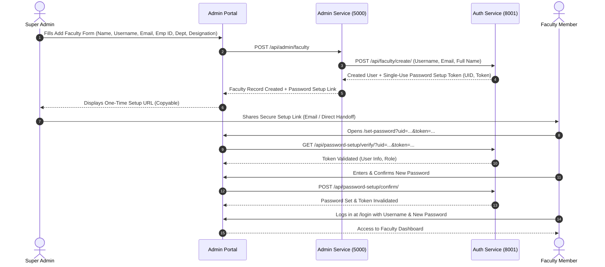
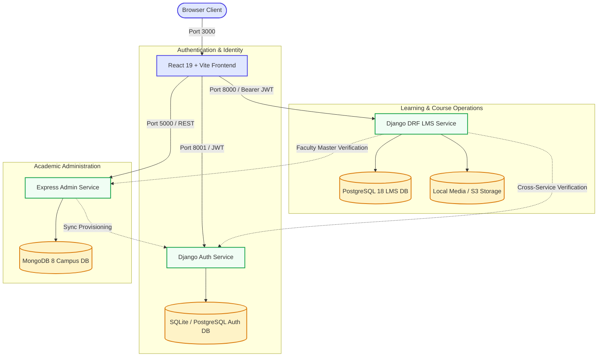

# CampusOS — University Campus & Learning Management System

> **CampusOS** is a modern, distributed Campus Operating System and Learning Management System (LMS) designed for higher education institutions. It connects administrative governance, academic planning, digital coursework, and student engagement into a unified, role-based platform.

---

## 1. Project Overview

### The Problem
Higher education institutions frequently suffer from fragmented software stacks:
- Administrative staff manage departments and course catalogues in one system.
- Instructors post learning materials, track attendance, and assign grades in another.
- Students are forced to juggle disconnected portals, opaque course codes, and unlinked logins.
- Authentication across portals is cumbersome, error-prone, and prone to cross-session contamination.

### The Solution: CampusOS
CampusOS provides a cohesive, multi-service architecture that bridges administrative master records with day-to-day academic execution:
- **Centralized Identity & Unified Provisioning**: Super Admins provision Faculty and Students through single-step workflows that generate secure, one-time activation links.
- **Academic Term & Offering Management**: Courses are scheduled as Offerings within distinct Academic Terms (Active, Completed, Upcoming) with assigned Faculty instructors and seat capacities.
- **Learning Content Delivery**: Instructors author hierarchical course content (Modules → Lessons → Learning Resources) with strict draft-to-publish controls.
- **Attendance Management with Audit Logging**: Live attendance sessions automatically synchronize with active course rosters, allowing audited corrections and real-time student attendance rate computation.
- **Assignment Lifecycle**: Creation, deadline enforcement, student submissions, and instructor grading with feedback.
- **Per-Tab Session Isolation**: Genuinely independent sessions across browser tabs, enabling administrators, faculty, and students to operate concurrently in the same browser profile without credential bleed.

### Target Users
1. **Super Administrators**: University registrars, academic deans, and IT administrators overseeing departments, faculty rosters, student admissions, and course scheduling.
2. **Faculty Members**: Professors, department heads, and lecturers managing enrolled student rosters, coursework, attendance, and grading.
3. **Students**: Undergraduate and postgraduate students actively enrolled in university courses, reviewing materials, tracking attendance percentages, and submitting work.

---

## 2. User Roles and Permissions

CampusOS enforces strict Role-Based Access Control (RBAC) across all frontend views and backend microservices.

```text
┌────────────────────────────────────────────────────────────────────────┐
│                        ROLE CAPABILITIES MATRIX                        │
├──────────────────────────────┬─────────────┬─────────────┬─────────────┤
│ Capability / Resource        │ Super Admin │   Faculty   │   Student   │
├──────────────────────────────┼─────────────┼─────────────┼─────────────┤
│ Manage Departments & Courses │     Yes     │    No       │    No       │
│ Provision Faculty & Students │     Yes     │    No       │    No       │
│ Create & Activate Terms      │     Yes     │    No       │    No       │
│ Schedule Course Offerings    │     Yes     │    No       │    No       │
│ Assign Faculty to Offerings  │     Yes     │    No       │    No       │
│ Enroll / Drop Students       │     Yes     │    No       │    No       │
│ Author Modules & Lessons     │     Yes     │  Assigned   │    No       │
│ Upload & Publish Materials   │     Yes     │  Assigned   │    No       │
│ Download Course Materials    │     Yes     │  Assigned   │  Enrolled   │
│ Create Assignments           │     Yes     │  Assigned   │    No       │
│ Submit Assignment Work       │     No      │    No       │  Enrolled   │
│ Grade Submissions & Feedback │     Yes     │  Assigned   │    No       │
│ Create Attendance Sessions   │     Yes     │  Assigned   │    No       │
│ Mark & Correct Attendance    │     Yes     │  Assigned   │    No       │
│ View Personal Attendance     │     No      │    No       │  Personal   │
│ View Administrative Reports  │     Yes     │ Department  │    No       │
└──────────────────────────────┴─────────────┴─────────────┴─────────────┘
```

### Detailed Role Descriptions

#### Super Admin
- **Department & Course Governance**: Creates, updates, and archives academic departments and master course catalogue records.
- **Identity & Account Provisioning**: Registers new faculty members and provisions student profiles, generating secure, single-use password activation links.
- **Academic Term Lifecycle**: Defines academic years and terms (`ACTIVE`, `UPCOMING`, `COMPLETED`), opens/closes enrollment windows, and manages term transitions.
- **Course Offering Operations**: Schedules course offerings per term, assigns or reassigns faculty instructors, defines seat capacities, and enrolls students.
- **Auditing & Reporting**: Generates university-wide reports across enrollment, attendance, grade distributions, and faculty assignments.

#### Faculty Instructor
- **Independent Portal Access**: Authenticates into an instructor-specific dashboard isolated from other sessions.
- **Assigned Courses**: Automatically filtered to only view and manage course offerings genuinely assigned to them.
- **Course Materials Workflow**: Structures learning content into Modules and Lessons. Uploads PDF/PPT/DOC documents and links external resources. Toggles draft vs published state.
- **Attendance Management**: Schedules attendance sessions for assigned offerings. The system automatically populates the roster of enrolled students as Present; faculty mark Absences/Tardiness with required audit reasons.
- **Assignments & Grading**: Authors assignments with deadlines, weightage, and late submission rules. Reviews submitted student work, assigns marks, and provides qualitative feedback.
- **Academic Tools**: Manages weekly timetables, tracks gradebook items, and broadcasts course-wide announcements.

#### Student
- **Enrolled Courses Dashboard**: Views actively enrolled courses with human-readable department names, instructor names, and term labels (never raw database IDs).
- **Learning Resources**: Browses published course modules and lessons; downloads permitted lecture notes and study resources.
- **Assignment Submission**: Reviews upcoming deadlines, submits assignment text and/or file attachments, and views graded results with instructor feedback.
- **Personal Attendance Tracking**: Real-time visibility into total sessions, attended sessions, and attendance percentages per course offering.
- **Notifications & Timetable**: Receives alerts for newly published lessons and assignments; views the weekly lecture schedule.

---

## 3. Complete User Workflows

### Faculty Provisioning & Account Activation


> **Note on Email Delivery**: CampusOS defaults to local/console email mode during development. When an account is created, the system generates an instant, copyable one-time password setup link in the UI. In production, configuring SMTP credentials enables automatic email dispatch.

### Student Provisioning Workflow
1. Super Admin navigates to **Students → Provision Student**.
2. Fills out student details:
   - **Personal & Login**: Full Name, Email Address, Username.
   - **Academic Details**: Registration Number (e.g. `2026CSE002`), Department, Admission Year, Current Semester (1–8).
3. Super Admin submits the form:
   - LMS Service validates field constraints and checks for duplicate usernames/emails against Auth Service.
   - Auth Service creates the authentication account with the `student` role.
   - LMS Service creates the linked `StudentProfile` keyed by the real `auth_user_id`.
   - A secure password setup token is generated.
4. Super Admin copies the generated setup link and provides it to the student.
5. The student opens the link, sets their password, and logs into the Student Portal.

### Academic Setup Workflow (Recommended Sequence)
To schedule and run academic courses correctly, follow this chronological order:
1. **Create Departments**: Admin registers academic departments (e.g. Computer Science and Engineering, Electronics).
2. **Create Course Master Catalogue**: Admin creates base courses with codes and credit hours (e.g. `CS101`, `CS355`).
3. **Provision Faculty & Students**: Admin creates instructor and student accounts.
4. **Create Academic Term**: Admin creates the term (e.g., `Odd Semester 2026`) and marks it as `ACTIVE`.
5. **Schedule Course Offerings**: Admin schedules offerings under the active term, defining course code, section (e.g., `A`), and capacity.
6. **Assign Faculty**: Admin assigns the primary instructor to the offering (resolving to their MongoDB/Auth record).
7. **Enroll Students**: Admin enrolls active students into the course offering.

> **Concept Clarity**:
> - **Course**: The universal subject definition (e.g., `CS101 - Introduction to Computer Science`, 4 Credits).
> - **Academic Term**: The temporal calendar period (e.g., `Odd Semester 2026`, Aug–Dec 2026).
> - **Course Offering**: A specific scheduled instance of a Course within an Academic Term, held in a designated Section (e.g., `CS101 - Section A` in `Odd Semester 2026`), taught by a specific Faculty instructor, with a finite student roster.

### Course Materials Workflow
1. Faculty logs into the Faculty Portal and navigates to **Course Content**.
2. Active offerings for the currently active term are selected by default.
3. Faculty clicks **Create Module** (e.g., `Module 1: Foundations of Computing`). Content can be saved as a Draft (`is_published: false`) or Published immediately.
4. Inside each module, Faculty adds **Lessons** with descriptive notes and duration estimates.
5. Faculty attaches **Learning Resources** to lessons or modules:
   - **Uploaded Files**: Lecture slides, lab sheets, reading materials (`.pdf`, `.docx`, `.pptx`, `.zip`, `.txt`).
   - **External Links**: Research articles, video lectures, reference documentation.
6. **Student Visibility Rules**:
   - Enrolled students only see **published** modules and lessons.
   - Non-enrolled students are strictly denied access (HTTP 403).
   - Draft materials remain completely hidden from students until the instructor toggles publish.

### Attendance Workflow
1. Faculty opens **Attendance** and selects the course offering.
2. Clicks **Take Attendance / Create Session**:
   - Specifies session date, start/end time, session type (`REGULAR`, `LAB`, `EXTRA`), and topic.
   - Upon creation, the backend **automatically populates all actively enrolled students** as `PRESENT`, completely preventing empty rosters.
3. Faculty clicks **Mark Attendance** to open the roster modal:
   - Enrolled students appear with their registration numbers and names.
   - Faculty can mark any student as `ABSENT` or `LATE`.
   - Modifying a saved record prompts for an **audit reason** (e.g., *"Medical certificate submitted"*), which is permanently recorded in the audit log.
4. Students immediately see updated attendance records, total sessions, and calculated percentage on their portal (`/student/attendance` and `/student/courses`).
5. Super Admins can query course-wise and student-wise attendance reports from `/api/attendance/offerings/<id>/report/`.

### Assignment & Grading Workflow
1. Faculty navigates to **Assignments** and clicks **Create Assignment**.
2. Enters title, description, due date, maximum marks, weightage percentage, and late submission rules.
3. When published, enrolled students receive notifications and view the assignment under their enrolled course.
4. Students submit work via rich text response and/or file attachment prior to the deadline.
5. Faculty views the class submission list, inspects submitted work, enters numerical marks, and writes qualitative feedback.
6. The student's portal immediately updates with their marks, feedback, and submission timestamp.

---

## 4. Application Architecture



### Data Ownership by Service

| Service | Technology | Port | Owned Entities & Data |
| :--- | :--- | :--- | :--- |
| **Auth Service** | Django + DRF + SimpleJWT | `8001` | User accounts, credentials, password hashes, JWT token issuance & refresh, roles (`super_admin`, `faculty`, `student`), single-use password setup tokens. |
| **Admin Service** | Node.js + Express + Mongoose | `5000` | Department master catalogue, Base Course catalogue, Faculty master profile records (`employeeId`, contact, designation), HOD mappings. |
| **LMS Service** | Django + DRF + Daphne | `8000` | Academic Terms, Course Offerings, Student Profiles, Course Enrollments, Modules, Lessons, Uploaded Course Resources, Attendance Sessions, Attendance Records with audit logs, Assignments, Submissions, Grades, Timetable, Notifications. |
| **Frontend** | React 19 + Vite + Tailwind | `3000` | Client-side routing, per-tab session storage, role-tailored dashboards (Super Admin, Faculty, Student), interactive modals and data tables. |

---

## 5. Technology Stack

### Frontend
- **Framework**: React 19.0.0
- **Build Tool**: Vite 6.4.6
- **Styling**: Tailwind CSS v4.0.0
- **Routing**: React Router DOM 7.1.3
- **Icons**: Lucide React
- **HTTP Client**: Axios 1.7.9 (configured with per-tab `sessionStorage` token interceptors)

### Backend: Admin Service
- **Runtime**: Node.js v20+ / v24+
- **Framework**: Express 5.1.0
- **Database Driver**: Mongoose 9.2.1
- **Database**: MongoDB 8.0+
- **Utilities**: CORS, Dotenv

### Backend: LMS Service
- **Runtime**: Python 3.12+ / 3.13+
- **Framework**: Django 5.2 (LTS)
- **API Framework**: Django REST Framework 3.16.1
- **ASGI Server**: Daphne 4.2.3
- **Database Driver**: `psycopg` (v3) / `psycopg2-binary`
- **Database**: PostgreSQL 16+ / 18+
- **File Handling**: Pillow 12.1.1
- **Token Verification**: PyJWT 2.10.1

### Backend: Auth Service
- **Runtime**: Python 3.12+ / 3.13+
- **Framework**: Django 6.1 / 5.2
- **API Framework**: Django REST Framework
- **JWT Provider**: `djangorestframework-simplejwt`
- **CORS Handling**: `django-cors-headers`
- **Database**: SQLite (Development) / PostgreSQL (Production)

---

## 6. Project Folder Structure

```text
CampusOS/
├── .gitignore                          # Root ignore rules (venv, node_modules, .env, media)
├── README.md                           # Master project manual (this document)
│
├── frontend/                           # React 19 + Vite Frontend Application
│   ├── .env.example                    # Frontend environment template
│   ├── index.html                      # HTML entry point
│   ├── package.json                    # Frontend dependencies & scripts
│   ├── vite.config.js                  # Vite configuration & path aliases (@/)
│   └── src/
│       ├── components/                 # Reusable UI widgets (DataTable, Modal, PageHeader)
│       ├── context/                    # AuthContext (tab-isolated session management)
│       ├── hooks/                      # Custom hooks (useAuth)
│       ├── pages/
│       │   ├── admin/                  # Super Admin management views (Faculty, Students, Offerings)
│       │   ├── faculty/                # Faculty views (Courses, Content, Attendance, Assignments)
│       │   ├── student/                # Student portal views (Courses, Attendance, Materials)
│       │   ├── auth/                   # Login & Password Setup screens
│       │   └── LandingPage.jsx         # Public university portal landing
│       └── services/                   # Axios API clients (api.js, tokenStorage.js, facultyService.js)
│
├── backend/                            # Express Admin Microservice (Port 5000)
│   ├── .env.example                    # Admin backend environment template
│   ├── package.json                    # Node.js dependencies
│   └── src/
│       ├── config/db.js                # MongoDB connection handler
│       ├── models/                     # Mongoose schemas (Department, Faculty, Course)
│       ├── controllers/                # Admin controllers with cross-service compensation
│       ├── routes/                     # REST routes (/api/admin/...)
│       ├── services/                   # Business logic layer
│       ├── app.js                      # Express application setup
│       └── server.js                   # Server bootstrap listener
│
├── backend/lms-service/                # Django LMS Microservice (Port 8000)
│   ├── .env.example                    # LMS environment template
│   ├── manage.py                       # Django CLI management entry
│   ├── requirements.txt                # Python dependencies
│   ├── config/                         # Core Django settings, URLs, and stateless JWT auth
│   └── apps/
│       ├── academics/                  # Terms, Course Offerings, Enrollments, Faculty Matcher
│       ├── attendance/                 # Sessions, Attendance Records, Audited Corrections, Reports
│       ├── learning/                   # Modules, Lessons, Resources, Draft/Publish controls
│       ├── assignments/                # Assignments, Submissions, Evaluation & Grading
│       ├── students/                   # Student profiles, Unified student provisioning
│       ├── timetable/                  # Lecture schedules & day-of-week slots
│       ├── grades/                     # Gradebook items, weightages, grade matrix
│       ├── notifications/              # Student/Faculty notification events
│       └── reports/                    # Analytics & administrative export views
│
└── backend/python-service/             # Django Auth Microservice (Port 8001)
    ├── .env.example                    # Auth service environment template
    ├── manage.py                       # Django CLI management entry
    ├── requirements.txt                # Python dependencies
    ├── config/                         # Django settings, SimpleJWT config, URLs
    └── accounts/                       # CustomUser model, setup tokens, verification endpoints
```

---

## 7. Local Development Setup

Follow these exact Windows PowerShell instructions to set up and run CampusOS locally.

### Prerequisites
- Node.js (v20 or v24 recommended) & npm.
- Python 3.12 or 3.13 installed with PATH enabled.
- MongoDB Server running on `127.0.0.1:27017`.
- PostgreSQL 16+ or 18+ running on `127.0.0.1:5432` with database `campusos_lms` created.

### Step 1: Clone and Configure Environment Files

```powershell
# Open Windows PowerShell in your projects directory
cd c:\path\to\CampusOS

# Copy environment templates
Copy-Item backend\.env.example backend\.env
Copy-Item backend\lms-service\.env.example backend\lms-service\.env
Copy-Item backend\python-service\.env.example backend\python-service\.env
Copy-Item frontend\.env.example frontend\.env
```

### Step 2: Set Up Backend Admin Service (Port 5000)

```powershell
cd c:\path\to\CampusOS\backend
npm install
# Start Admin Service
node src\server.js
# Output: Campus LMS API running on port 5000
```

### Step 3: Set Up Auth Service (Port 8001)

Open a **second PowerShell window**:

```powershell
cd c:\path\to\CampusOS\backend\python-service

# Create and activate virtual environment
python -m venv .venv
.\.venv\Scripts\Activate.ps1

# Install dependencies
pip install -r requirements.txt

# Run migrations
python manage.py migrate

# Start Auth Service on port 8001
python manage.py runserver 8001 --noreload
```

### Step 4: Set Up LMS Service (Port 8000)

Open a **third PowerShell window**:

```powershell
cd c:\path\to\CampusOS\backend\lms-service

# Create and activate virtual environment
python -m venv .venv
.\.venv\Scripts\Activate.ps1

# Install dependencies
pip install -r requirements.txt

# Run database migrations against PostgreSQL
python manage.py migrate

# Start LMS Service on port 8000
python manage.py runserver 8000 --noreload
```

### Step 5: Set Up Frontend (Port 3000)

Open a **fourth PowerShell window**:

```powershell
cd c:\path\to\CampusOS\frontend

# Install dependencies
npm install

# Start Vite development server
npm run dev
# Output: Local: http://localhost:3000/
```

### Test User Credentials for Local Testing

| Role | Username | Password | Notes |
| :--- | :--- | :--- | :--- |
| **Super Admin** | `admin_live` | `TestAdmin@123` | Full access to departments, users, terms, and offerings |
| **Faculty** | `faculty_live` | `TestFaculty@123` | Dr. Kalpana Singh (Assigned to CS101 in Odd Semester 2026) |
| **Student** | `01_anurag` | `TestStudent@123` | Anurag (`2026CSE002`, Enrolled in CS101 & CS355) |

---

## 8. Environment Variables

### 1. Frontend (`frontend/.env`)
Variables consumed by Vite **must** start with the `VITE_` prefix.

> **Security Rule**: `VITE_` variables are statically bundled into client-side JavaScript. **Never put database passwords, private keys, or API secrets in frontend `.env` files.**

```env
# LMS Service API base URL
VITE_LMS_API_URL=http://127.0.0.1:8000

# Auth Service API base URL
VITE_AUTH_API_URL=http://127.0.0.1:8001

# Express Admin Service API base URL
VITE_ADMIN_API_URL=http://127.0.0.1:5000
```

### 2. Admin Service (`backend/.env`)
```env
PORT=5000
MONGO_URI=mongodb://127.0.0.1:27017/campusos
AUTH_SERVICE_URL=http://127.0.0.1:8001
LMS_SERVICE_URL=http://127.0.0.1:8000
CORS_ORIGIN=http://localhost:3000
```

### 3. Auth Service (`backend/python-service/.env`)
```env
SECRET_KEY=replace-with-a-secure-production-secret-key
DEBUG=False
ALLOWED_HOSTS=localhost,127.0.0.1,campusos.yourdomain.edu

# JWT Configuration
ACCESS_TOKEN_LIFETIME_MINUTES=60
REFRESH_TOKEN_LIFETIME_DAYS=7

# CORS Configuration
CORS_ALLOWED_ORIGINS=http://localhost:3000,http://127.0.0.1:3000,https://campusos.yourdomain.edu
```

### 4. LMS Service (`backend/lms-service/.env`)
```env
SECRET_KEY=replace-with-a-secure-lms-secret-key
DEBUG=False
ALLOWED_HOSTS=127.0.0.1,localhost,campusos.yourdomain.edu

# PostgreSQL Database Configuration
DB_NAME=campusos_lms
DB_USER=postgres
DB_PASSWORD=replace-with-your-db-password
DB_HOST=127.0.0.1
DB_PORT=5432

LMS_PORT=8000

# JWT Cross-Verification (Matches Auth Service Secret)
JWT_SECRET_KEY=replace-with-a-secure-production-secret-key
JWT_ALGORITHM=HS256
JWT_DEFAULT_ROLE=student
AUTH_SERVICE_URL=http://127.0.0.1:8001

# Express Admin Backend URL
ADMIN_SERVICE_URL=http://127.0.0.1:5000
```

---

## 9. API Documentation

### Auth Service (Port 8001)

| Method | Endpoint | Access | Purpose |
| :--- | :--- | :--- | :--- |
| `POST` | `/api/token/` | Public | Authenticates credentials and returns JWT Access & Refresh tokens. |
| `POST` | `/api/token/refresh/` | Public | Exchanges a valid refresh token for a new access token. |
| `GET` | `/api/user/me/` | Authenticated | Retrieves current authenticated user profile and verified role. |
| `POST` | `/api/faculty/create/` | Admin only | Provisions faculty authentication account and generates setup token. |
| `POST` | `/api/faculty/setup-link/`| Admin only | Generates or regenerates a one-time password setup link. |
| `GET` | `/api/password-setup/verify/` | Public | Verifies token validity (`?uid=<uid>&token=<token>`). |
| `POST` | `/api/password-setup/confirm/`| Public | Consumes token, validates strength, and sets new password. |

### Admin Service (Port 5000)

| Method | Endpoint | Access | Purpose |
| :--- | :--- | :--- | :--- |
| `GET` | `/api/health` | Public | Health check reporting service uptime. |
| `GET` | `/api/admin/departments` | Public / Auth | Lists academic departments. |
| `POST` | `/api/admin/departments` | Admin | Creates a new academic department. |
| `GET` | `/api/admin/courses` | Public / Auth | Lists universal course catalogue records. |
| `POST` | `/api/admin/courses` | Admin | Adds a new course to the catalogue. |
| `GET` | `/api/admin/faculty` | Public / Auth | Lists faculty master profiles with employee IDs and departments. |
| `POST` | `/api/admin/faculty` | Admin | Provisions faculty in Admin DB & Auth Service with rollback. |
| `PUT` | `/api/admin/faculty/:id` | Admin | Updates faculty record details. |
| `DELETE`| `/api/admin/faculty/:id` | Admin | Soft-deactivates faculty member. |

### LMS Service (Port 8000)

| Method | Endpoint | Access | Purpose |
| :--- | :--- | :--- | :--- |
| `GET` | `/api/health/` | Public | Reports LMS service health and PostgreSQL database status. |
| `GET` | `/api/academics/terms/` | Authenticated | Lists academic terms (`ACTIVE`, `COMPLETED`, `UPCOMING`). |
| `POST` | `/api/academics/terms/` | Admin | Creates a new academic term. |
| `POST` | `/api/academics/terms/<id>/activate/` | Admin | Activates term; automatically completes previous active term. |
| `GET` | `/api/academics/offerings/` | Role Filtered | Lists course offerings (Faculty only see their assigned offerings). |
| `POST` | `/api/academics/offerings/` | Admin | Schedules course offering with section, term, and assigned faculty. |
| `PATCH`| `/api/academics/offerings/<id>/` | Admin | Updates offering capacity, status, or reassigns instructor. |
| `GET` | `/api/academics/offerings/<id>/students/` | Faculty/Admin | Retrieves enrolled student roster for an offering. |
| `POST` | `/api/academics/offerings/<id>/enroll/` | Admin/Student| Enrolls a student in the course offering. |
| `POST` | `/api/students/unified-provision/` | Admin | Creates student Auth account, StudentProfile, and setup link. |
| `GET` | `/api/learning/offerings/<id>/modules/` | Enrolled / Fac | Lists modules (students see published; faculty see draft + published). |
| `POST` | `/api/learning/offerings/<id>/modules/` | Assigned Fac | Adds a module to the course offering. |
| `POST` | `/api/learning/modules/<id>/lessons/` | Assigned Fac | Adds a lesson to a module. |
| `POST` | `/api/learning/lessons/<id>/resources/`| Assigned Fac | Attaches link or file resource to a lesson. |
| `POST` | `/api/attendance/offerings/<id>/sessions/` | Assigned Fac | Creates attendance session and auto-populates enrolled roster. |
| `POST` | `/api/attendance/sessions/<id>/mark/` | Assigned Fac | Marks or updates attendance records with audit logging. |
| `GET` | `/api/attendance/my-summary/` | Enrolled Student | Retrieves personal attendance rates and statistics per course. |
| `GET` | `/api/assignments/offerings/<id>/` | Enrolled / Fac | Lists assignments for the course offering. |
| `POST` | `/api/assignments/offerings/<id>/` | Assigned Fac | Creates a new assignment. |
| `POST` | `/api/assignments/<id>/submit/` | Enrolled Student | Submits response text and/or file for an assignment. |
| `POST` | `/api/assignments/submissions/<id>/grade/` | Assigned Fac | Grades a student submission with marks and feedback. |

---

## 10. Security & Data Protection

- **Stateless JWT Verification**: The LMS service validates SimpleJWT Bearer tokens statelessly using the shared secret key. User identity, verified role, and permissions are reconstructed on each request without local database coupling.
- **Tab-Isolated Authentication**: Tokens and profile state are isolated per tab using `sessionStorage`. Logging in as Super Admin in Tab 2 will **never** overwrite or bleed into a Faculty session active in Tab 1 within the same browser profile.
- **Single-Use Activation Tokens**: Setup tokens are generated using Django's cryptographic HMAC generator with salt and user timestamp hashing (`PasswordResetTokenGenerator`). Once used, the token is permanently invalidated.
- **Cross-Service RBAC Matcher**: Instructors cannot view, modify, grade, or take attendance for courses they do not teach. The backend cross-references the request user against MongoDB ObjectIds, employee IDs, usernames, and normalized name variants.
- **IDOR Data Isolation**: Students attempting to query another student's attendance history, draft modules, or submission records receive an immediate HTTP 403 Forbidden.
- **File Upload Validation**: Course materials and assignment submissions are validated against allowable MIME types and strict file size boundaries (e.g. executable `.exe` files are rejected).

---

## 11. Production Deployment Guide

### Target Infrastructure Architecture

```text
                  Internet
                     │ (HTTPS / 443)
                     ▼
             [ Cloudflare / CDN ]
                     │
             [ Nginx Reverse Proxy ]
       ┌─────────────┼─────────────┬─────────────┐
       │             │             │             │
       ▼             ▼             ▼             ▼
[ Frontend:    [ Admin Svc:  [ Auth Svc:   [ LMS Svc:
  Vercel /       Node.js /     Gunicorn /    Daphne /
  Nginx Static]  PM2 (5000)]   Django (8001)]Django (8000)]
                     │             │             │
                     ▼             ▼             ▼
               [(MongoDB     [(Managed     [(Managed
                 Atlas)]       PostgreSQL)]  PostgreSQL)]
                                                 │
                                                 ▼
                                           [(AWS S3 /
                                             Persistent Volume)]
```

### Recommended Hosting Services

| Component | Recommended Production Provider | Deployment Mechanism |
| :--- | :--- | :--- |
| **Frontend** | Vercel, Cloudflare Pages, or Netlify | Static Site / Single Page App (`npm run build`) |
| **Admin Service** | AWS EC2, DigitalOcean Droplet, or Railway | Node.js process managed via PM2 or Docker |
| **Auth Service** | AWS ECS, DigitalOcean App Platform, or Render | Gunicorn WSGI container behind reverse proxy |
| **LMS Service** | AWS ECS, DigitalOcean Droplet, or Render | Daphne ASGI container behind reverse proxy |
| **PostgreSQL** | AWS RDS PostgreSQL or DigitalOcean Managed DB | Managed PostgreSQL 16+ with automated backups |
| **MongoDB** | MongoDB Atlas | M10+ Cluster with VPC peering or IP whitelist |
| **Media / Files** | Amazon S3 or DigitalOcean Spaces | `django-storages` S3 storage backend |

### Production Configuration Checklist
1. **Disable DEBUG**: Ensure `DEBUG=False` in both `backend/lms-service/.env` and `backend/python-service/.env`.
2. **Generate Cryptographic Secrets**: Replace default development secrets with 64-character random keys generated via `openssl rand -hex 32`.
3. **Configure ALLOWED_HOSTS**: Restrict `ALLOWED_HOSTS` to institutional domain names (e.g., `api.campusos.edu,auth.campusos.edu`).
4. **Enforce HTTPS**: Set `SECURE_SSL_REDIRECT = True`, `SESSION_COOKIE_SECURE = True`, and `CSRF_COOKIE_SECURE = True`.
5. **CORS Restrictions**: Explicitly list institutional frontend origins in `CORS_ALLOWED_ORIGINS` (never use `CORS_ALLOW_ALL_ORIGINS = True`).
6. **Persistent Media Storage**: In containerized environments, media uploads (`/media/`) must be stored on persistent network volumes or S3 buckets to prevent data loss on container rebuilds.

---

## 12. Known Limitations

1. **SMTP Email Configuration**: By default, password activation links are displayed in the Super Admin interface for manual copying and sharing. Enabling automatic email delivery requires setting `EMAIL_HOST`, `EMAIL_HOST_USER`, `EMAIL_HOST_PASSWORD`, and `EMAIL_PORT` in `backend/python-service/.env`.
2. **Multi-Section Concurrent Lectures**: Course offerings support one primary assigned instructor per offering. Team-teaching or co-instructor roles require scheduling secondary sections.
3. **Real-Time WebSockets**: Live in-app notifications operate over HTTP polling. Real-time WebSocket broadcasting requires provisioning a Redis instance and enabling the Django Channels Redis layer.

---

## 13. Troubleshooting & FAQ

### 1. "You are not the assigned instructor for this course offering"
- **Cause**: The faculty member is attempting to access content, attendance, or assignments for an offering assigned to another professor, or the offering was scheduled under a different faculty ID.
- **Fix**: Super Admin opens **Admin → Course Offerings**, clicks **Edit** on the offering, and selects the correct instructor from the dropdown. The change reflects immediately.

### 2. Password setup link reports "Link is invalid, expired, or has already been used"
- **Cause**: Setup links are single-use and time-limited. If the link was clicked and completed previously, or expired, it cannot be reused.
- **Fix**: Super Admin navigates to **Admin → Faculty**, selects the faculty member, and clicks **Regenerate Setup Link**.

### 3. Student Courses page shows blank or undefined term
- **Cause**: Course offerings scheduled without an associated Academic Term, or student enrollments referencing archived or unassigned terms.
- **Fix**: Ensure the active academic term is in `ACTIVE` status under **Admin → Academic Terms**, and verify that the offering is scheduled under that term.

### 4. Database Connection Timeout on Startup
- **MongoDB**: Verify the local service is active: `Get-Service MongoDB` in PowerShell.
- **PostgreSQL**: Verify PostgreSQL is listening on port 5432: `Test-NetConnection -Port 5432 -ComputerName 127.0.0.1`.

---

## 14. License & Authorship

Developed by the CampusOS Engineering Team. All rights reserved.
For technical support or institutional deployment inquiries, contact your university IT administrator.
