# CampusOS — LMS Backend Service

The **CampusOS LMS Backend** is an independent Django REST Framework microservice responsible for academic profiles, course offerings, enrollments, learning content, attendance, assignments, and gradebooks.

---

## 1. Core Academic Entity-Relationship (ER) Architecture

The foundational academic data model is split across two core domain applications:
* **`apps/students`**: Manages student academic profiles referencing external Auth and Admin identities.
* **`apps/academics`**: Manages institutional terms, course offerings, and student enrollments.

### Entity-Relationship Diagram

```mermaid
erDiagram
    STUDENT_PROFILE {
        bigint id PK
        string auth_user_id UK "External Auth Service Ref (max 64)"
        string registration_number UK "Institutional roll/reg number"
        string department_id "External Admin Department Ref (max 64)"
        int admission_year "Admission year"
        smallint current_semester "Current semester"
        boolean is_active "Soft status flag"
        datetime created_at
        datetime updated_at
    }

    ACADEMIC_TERM {
        bigint id PK
        string name "Human-readable name"
        string academic_year "Format: YYYY-YYYY"
        smallint term_number "Sequence in year"
        date start_date "Term start date"
        date end_date "Term end date (> start_date)"
        string status "UPCOMING | ACTIVE | COMPLETED | ARCHIVED"
        boolean is_enrollment_open "Enrollment window open flag"
        datetime created_at
        datetime updated_at
    }

    COURSE_OFFERING {
        bigint id PK
        string course_id "External Admin Course Ref (max 64)"
        string faculty_id "External Admin Faculty Ref (max 64)"
        string department_id "External Admin Department Ref (max 64)"
        bigint academic_term_id FK "References AcademicTerm"
        string section "Section identifier"
        int capacity "Maximum seat capacity (> 0)"
        string status "DRAFT | PUBLISHED | COMPLETED | CANCELLED"
        datetime created_at
        datetime updated_at
    }

    ENROLLMENT {
        bigint id PK
        bigint student_id FK "References StudentProfile"
        bigint course_offering_id FK "References CourseOffering"
        datetime enrolled_at "Enrollment timestamp"
        string status "ENROLLED | DROPPED | COMPLETED | AUDIT"
        datetime dropped_at "Drop timestamp (null if active)"
        datetime created_at
        datetime updated_at
    }

    ASSIGNMENT {
        bigint id PK
        bigint course_offering_id FK "References CourseOffering"
        bigint module_id FK "Optional References CourseModule"
        string title "Assignment title"
        text description "Overview summary"
        text instructions "Detailed guidelines & rubrics"
        decimal max_marks "Maximum points (> 0)"
        datetime due_date "Official deadline"
        boolean allow_late_submissions "Configurable late policy"
        datetime late_submission_deadline "Hard cutoff if late allowed"
        boolean allow_resubmissions "Configurable resubmission policy"
        smallint max_resubmissions "Maximum attempts allowed"
        boolean is_published "Draft vs Published state"
        string attachment "Optional brief document"
        datetime created_at
        datetime updated_at
    }

    ASSIGNMENT_SUBMISSION {
        bigint id PK
        bigint assignment_id FK "References Assignment"
        bigint student_id FK "References StudentProfile"
        text submission_text "Answer text or URL"
        string submission_file "Uploaded file up to 25MB"
        bigint file_size_bytes "Size in bytes"
        string file_mime_type "MIME type"
        smallint submission_number "Attempt count"
        datetime submitted_at "Submission timestamp"
        boolean is_late "Past due date flag"
        string status "SUBMITTED | RESUBMITTED | GRADED"
        decimal marks_obtained "Awarded marks (>= 0 and <= max_marks)"
        text feedback "Faculty qualitative evaluation"
        string graded_by_faculty_id "Faculty evaluator ref"
        datetime graded_at "Grading timestamp"
        datetime created_at
        datetime updated_at
    }

    ATTENDANCE_SESSION {
        bigint id PK
        bigint course_offering_id FK "References CourseOffering"
        date session_date "Date of instruction"
        time start_time "Optional session start"
        time end_time "Optional session end"
        string title "Lecture/lab topic"
        text description "Coverage syllabus details"
        string created_by_faculty_id "Faculty creator ref"
        datetime created_at
        datetime updated_at
    }

    ATTENDANCE_RECORD {
        bigint id PK
        bigint session_id FK "References AttendanceSession"
        bigint student_id FK "References StudentProfile"
        string status "PRESENT | ABSENT | LATE"
        string remarks "Optional remarks"
        text audit_reason "Mandatory explanation for corrections"
        string recorded_by_user_id "Faculty/Admin ref"
        datetime created_at
        datetime updated_at
    }

    TIMETABLE_ENTRY {
        bigint id PK
        bigint course_offering_id FK "References CourseOffering"
        string faculty_id "Assigned instructor ref"
        string day_of_week "MONDAY through SUNDAY"
        time start_time "Slot start time"
        time end_time "Slot end time (> start_time)"
        string room "Classroom or lab identifier"
        string building "Building / wing name"
        string entry_type "LECTURE | LAB | TUTORIAL | SEMINAR"
        boolean is_active "Active schedule flag"
        datetime created_at
        datetime updated_at
    }

    CALENDAR_EVENT {
        bigint id PK
        string title "Event title"
        text description "Event details"
        string event_type "ACADEMIC | HOLIDAY | EXAM | EVENT | DEADLINE"
        date start_date "Event start date"
        date end_date "Event end date (>= start_date)"
        time start_time "Optional start time"
        time end_time "Optional end time"
        bigint academic_term_id FK "Optional term reference"
        bigint course_offering_id FK "Optional course offering reference"
        string created_by_user_id "Creator user ref"
        boolean is_published "Published visibility flag"
        datetime created_at
        datetime updated_at
    }

    GRADE_ITEM {
        bigint id PK
        bigint course_offering_id FK "References CourseOffering"
        string name "Assessment component name"
        string item_type "ASSIGNMENT | EXAM | QUIZ | PROJECT | MIDTERM | FINAL | ATTENDANCE | OTHER"
        decimal max_marks "Maximum achievable marks (> 0)"
        decimal weightage_percentage "Optional percentage weightage"
        bigint assignment_id FK "Optional link to Assignment"
        string external_exam_id "External Exam Engine ref"
        boolean is_published "Publish toggle"
        datetime created_at
        datetime updated_at
    }

    GRADE_RECORD {
        bigint id PK
        bigint grade_item_id FK "References GradeItem"
        bigint student_id FK "References StudentProfile"
        decimal marks_obtained "Marks awarded (>= 0 and <= max_marks)"
        string letter_grade "Optional letter grade (e.g. A+, B)"
        text feedback "Qualitative faculty remarks"
        boolean is_published "Publication status"
        string graded_by_faculty_id "Faculty evaluator ref"
        datetime graded_at "Grading timestamp"
        datetime created_at
        datetime updated_at
    }

    FINAL_COURSE_GRADE {
        bigint id PK
        bigint course_offering_id FK "References CourseOffering"
        bigint student_id FK "References StudentProfile"
        decimal total_marks_obtained "Aggregate score"
        decimal total_max_marks "Total possible score"
        decimal percentage "Calculated percentage"
        string final_letter_grade "Confirmed official grade"
        text feedback "Overall performance remarks"
        boolean is_published "Publication toggle"
        datetime published_at "Official release timestamp"
        string graded_by_faculty_id "Faculty evaluator ref"
        datetime created_at
        datetime updated_at
    }

    ACADEMIC_TERM ||--o{ COURSE_OFFERING : "schedules"
    STUDENT_PROFILE ||--o{ ENROLLMENT : "registers"
    COURSE_OFFERING ||--o{ ENROLLMENT : "receives"
    COURSE_OFFERING ||--o{ ASSIGNMENT : "issues"
    STUDENT_PROFILE ||--o{ ASSIGNMENT_SUBMISSION : "submits"
    ASSIGNMENT ||--o{ ASSIGNMENT_SUBMISSION : "evaluates"
    COURSE_OFFERING ||--o{ ATTENDANCE_SESSION : "conducts"
    STUDENT_PROFILE ||--o{ ATTENDANCE_RECORD : "logs"
    ATTENDANCE_SESSION ||--o{ ATTENDANCE_RECORD : "records"
    COURSE_OFFERING ||--o{ TIMETABLE_ENTRY : "schedules"
    ACADEMIC_TERM ||--o{ CALENDAR_EVENT : "applies_to"
    COURSE_OFFERING ||--o{ CALENDAR_EVENT : "targets"
    COURSE_OFFERING ||--o{ GRADE_ITEM : "defines"
    GRADE_ITEM ||--o{ GRADE_RECORD : "contains"
    STUDENT_PROFILE ||--o{ GRADE_RECORD : "earns"
    COURSE_OFFERING ||--o{ FINAL_COURSE_GRADE : "issues"
    STUDENT_PROFILE ||--o{ FINAL_COURSE_GRADE : "receives"
    ASSIGNMENT ||--o{ GRADE_ITEM : "links (optional)"
```



---

## 2. Relational vs. External Boundaries

1. **Internal Foreign Keys**:
   * `CourseOffering.academic_term` → `AcademicTerm` (`on_delete=models.PROTECT`)
   * `Enrollment.course_offering` → `CourseOffering` (`on_delete=models.PROTECT`)
   * `Enrollment.student` → `StudentProfile` (`on_delete=models.CASCADE`)
2. **External Identifiers (Indexed `CharField(max_length=64)`)**:
   * `auth_user_id`: Reference to Shailesh's Django Auth service.
   * `course_id`: Reference to Node.js/Express Admin service `Course._id`.
   * `faculty_id`: Reference to Node.js/Express Admin service `Faculty._id`.
   * `department_id`: Reference to Node.js/Express Admin service `Department._id`.

---

## 3. PostgreSQL Database Constraints & Rules

* **Single Active Term**:
  * PostgreSQL conditional unique index: `CREATE UNIQUE INDEX unique_active_academic_term ON lms_academic_terms (status) WHERE status = 'ACTIVE'`.
  * Enforces that strictly **only one** `AcademicTerm` may have `ACTIVE` status institution-wide.
* **Concurrency-Safe Enrollment**:
  * Row-level locking via `CourseOffering.objects.select_for_update()` inside `transaction.atomic()` prevents over-enrollment under race conditions.
  * Conditional unique index: `CREATE UNIQUE INDEX unique_active_enrollment_per_student_offering ON lms_enrollments (student_id, course_offering_id) WHERE status = 'ENROLLED'`.
  * Prevents concurrent duplicate active enrollments while supporting add/drop re-enrollments.
* **Term Chronological Order**:
  * PostgreSQL check constraint: `CHECK (end_date > start_date)`.
* **Offering Capacity**:
  * PostgreSQL check constraint: `CHECK (capacity > 0)`.
* **Section Uniqueness**:
  * Composite unique index: `UNIQUE (course_id, academic_term_id, section)`.

---

## 4. Authentication & Authorization Boundary

The LMS relies on external JWTs issued by the Authentication service.

### JWT Header Requirement
All protected endpoints require a Bearer token:
```http
Authorization: Bearer <jwt_token>
```

### Expected JWT Claims
```json
{
  "sub": "<user_id>",
  "role": "student | faculty | admin",
  "email": "user@campus.edu",
  "department_id": "optional_dept_id",
  "exp": 1731234567
}
```

### Role-Based Access Control (RBAC) Matrix
| Endpoint Group | Student | Faculty | Academic Admin |
|---|---|---|---|
| `/api/students/profile/me/` | Read / Permitted Update | 403 Forbidden | 403 (use `/profile/{id}/`) |
| `/api/students/profile/{id}/` | Self only (IDOR Protected) | 403 Forbidden | Read / Full Update |
| `/api/academics/terms/` | Read | Read | Read / Create |
| `/api/academics/terms/{id}/activate/` | 403 Forbidden | 403 Forbidden | Execute Lifecycle Transition |
| `/api/academics/offerings/` | Read (Published only) | Read | Read / Create |
| `/api/academics/offerings/{id}/students/` | 403 Forbidden | Assigned Course Only | Full Roster Access |
| `/api/academics/offerings/{id}/enroll/` | Self Enrollment | 403 Forbidden | Enroll any student |
| `/api/academics/offerings/{id}/drop/` | Self Drop | 403 Forbidden | Drop any student |
| `/api/academics/enrollments/` | Own Enrollments | Assigned Courses | All Enrollments |
| `/api/assignments/offerings/{id}/` | Read (Published only) | Read / Create | Read / Create |
| `/api/assignments/{id}/` | Read (Published only) | Read / Update / Delete | Read / Update / Delete |
| `/api/assignments/{id}/publish/` | 403 Forbidden | Toggle Publish State | Toggle Publish State |
| `/api/assignments/{id}/submit/` | Submit / Resubmit (Enrolled only) | 403 Forbidden | 403 Forbidden |
| `/api/assignments/{id}/my-submission/` | Own Submission View | 403 Forbidden | 403 Forbidden |
| `/api/assignments/{id}/submissions/` | 403 Forbidden | Assigned Course Submissions | All Course Submissions |
| `/api/assignments/submissions/{id}/` | Own Submission Only | Assigned Course Submissions | All Submissions |
| `/api/assignments/submissions/{id}/grade/` | 403 Forbidden | Grade & Provide Feedback | Grade & Provide Feedback |
| `/api/attendance/offerings/{id}/sessions/` | Enrolled: View Session List | Read / Create Session | Read / Create Session |
| `/api/attendance/offerings/{id}/report/` | 403 Forbidden | Generate Course Report | Generate Course Report |
| `/api/attendance/sessions/{id}/` | 403 Forbidden | Read / Update / Delete | Read / Update / Delete |
| `/api/attendance/sessions/{id}/mark/` | 403 Forbidden | Mark Attendance (Present/Absent/Late) | Mark Attendance |
| `/api/attendance/records/{id}/` | Own Record (Read only) | Read / Correct (with Audit Reason) | Read / Correct (with Audit Reason) |
| `/api/attendance/my-summary/` | Subject-wise Percentages | 403 Forbidden | 403 Forbidden |
| `/api/attendance/my-history/` | Own Chronological History | 403 Forbidden | 403 Forbidden |
| `/api/timetable/offerings/{id}/` | Enrolled: View Class Slots | Read / Add Slot | Read / Add Slot |
| `/api/timetable/entries/{id}/` | Enrolled: View Slot | Read / Update / Delete | Read / Update / Delete |
| `/api/timetable/my-timetable/` | Own Enrolled Schedule | 403 Forbidden | 403 Forbidden |
| `/api/timetable/faculty-timetable/` | 403 Forbidden | Own Teaching Schedule | Query Any Faculty Schedule |
| `/api/timetable/calendar/` | Published & Enrolled Events | Read / Create Course Event | Full Read / Create Global Event |
| `/api/timetable/calendar/{id}/` | Published & Enrolled Events | Read / Update Course Event | Full Read / Update / Delete |
| `/api/grades/offerings/{id}/items/` | Enrolled: View Published Items | Read / Create Item | Read / Create Item |
| `/api/grades/offerings/{id}/gradebook/` | 403 Forbidden | View Course Gradebook | View Any Gradebook |
| `/api/grades/offerings/{id}/final-results/` | Enrolled: Own Published Final Grade | Publish Final Results | Publish Final Results |
| `/api/grades/items/{id}/` | Enrolled: Published Item Detail | Read / Update / Delete | Read / Update / Delete |
| `/api/grades/items/{id}/publish/` | 403 Forbidden | Toggle Publish State | Toggle Publish State |
| `/api/grades/items/{id}/marks/` | 403 Forbidden | Bulk Enter Student Marks | Bulk Enter Student Marks |
| `/api/grades/items/{id}/sync-assignment/` | 403 Forbidden | Sync Assignment Marks | Sync Assignment Marks |
| `/api/grades/items/{id}/sync-exam/` | 403 Forbidden | Trigger Exam Sync | Trigger Exam Sync |
| `/api/grades/records/{id}/` | Own Record (Published only) | Read / Update Marks & Feedback | Read / Update Marks & Feedback |
| `/api/grades/my-grades/` | Personal Published Results | 403 Forbidden | 403 Forbidden |

---

## 5. API Reference

### Health Check
* `GET /api/health/` — Probes application and live PostgreSQL connectivity. Returns `200 OK` or `503 Service Unavailable`.

### Student APIs (`/api/students/`)
* `POST /api/students/profile/` — Provision a student profile linked to `auth_user_id`.
* `GET /api/students/profile/me/` — Retrieve the authenticated student's profile.
* `PATCH /api/students/profile/me/` — Update permitted fields (`current_semester`).
* `GET /api/students/profile/me/enrollments/` — Retrieve enrolled courses for authenticated student.
* `GET /api/students/profile/{id}/` — Retrieve profile by ID (Self or Admin only).
* `PATCH /api/students/profile/{id}/` — Update profile by ID (Self or Admin only).

### Academic Term APIs (`/api/academics/terms/`)
* `GET /api/academics/terms/` — List terms. Query params: `?status=ACTIVE`, `?academic_year=2026-2027`.
* `POST /api/academics/terms/` — Create academic term (Admin only).
* `GET /api/academics/terms/current/` — Retrieve current active term.
* `GET /api/academics/terms/{id}/` — Retrieve term details.
* `PATCH /api/academics/terms/{id}/` — Update term (Admin only).
* `POST /api/academics/terms/{id}/activate/` — Activate term and mark previous as completed.
* `POST /api/academics/terms/{id}/complete/` — Complete term and close enrollment.
* `POST /api/academics/terms/{id}/enrollment-window/` — Body: `{"is_open": true|false}`.

### Course Offering APIs (`/api/academics/offerings/`)
* `GET /api/academics/offerings/` — List offerings. Query params: `?term=1`, `?department=...`, `?faculty=...`, `?status=PUBLISHED`.
* `POST /api/academics/offerings/` — Create offering (Admin only).
* `GET /api/academics/offerings/{id}/` — Retrieve offering details with available seats.
* `PATCH /api/academics/offerings/{id}/` — Update offering.
* `GET /api/academics/offerings/{id}/students/` — Class roster (Assigned faculty or Admin only).

### Enrollment APIs (`/api/academics/`)
* `POST /api/academics/offerings/{id}/enroll/` — Concurrency-safe enrollment via `select_for_update()`.
* `POST /api/academics/offerings/{id}/drop/` — Drop active enrollment.
* `GET /api/academics/enrollments/` — List enrollments scoped to user role.

### Learning Management & Course Content APIs (`/api/learning/`)
* `GET /api/learning/offerings/{offering_id}/modules/` — List course modules (enrolled students see published only; instructor/admin see all).
* `POST /api/learning/offerings/{offering_id}/modules/` — Create module (Assigned instructor or Admin only).
* `GET /api/learning/modules/{id}/` — Module details.
* `PATCH /api/learning/modules/{id}/` — Update module title, description, order (Instructor/Admin).
* `DELETE /api/learning/modules/{id}/` — Delete module and child content (Instructor/Admin).
* `POST /api/learning/modules/{id}/publish/` — Toggle module publish state with optional lesson cascade.
* `POST /api/learning/modules/{module_id}/lessons/` — Create lesson in module (Instructor/Admin).
* `GET /api/learning/lessons/{id}/` — Lesson detail with content and completion status (Enrolled students see published only).
* `PATCH /api/learning/lessons/{id}/` — Update lesson content/metadata (Instructor/Admin).
* `DELETE /api/learning/lessons/{id}/` — Delete lesson (Instructor/Admin).
* `POST /api/learning/lessons/{id}/publish/` — Toggle lesson publish state (Instructor/Admin).
* `POST /api/learning/lessons/{id}/progress/` — Student marks lesson completed/incomplete (`{"is_completed": bool}`).
* `POST /api/learning/lessons/{lesson_id}/resources/` — Upload document (PDF, docx, pptx) or external link to lesson (Instructor/Admin).
* `POST /api/learning/modules/{module_id}/resources/` — Attach resource directly at module level (Instructor/Admin).
* `GET /api/learning/resources/{id}/` — Retrieve resource metadata and file/URL.
* `DELETE /api/learning/resources/{id}/` — Delete resource (Instructor/Admin).

### Assignment Management & Submissions APIs (`/api/assignments/`)
* `GET /api/assignments/offerings/{offering_id}/` — List assignments (enrolled students see published only with submission status; instructor/admin see all with submission counts).
* `POST /api/assignments/offerings/{offering_id}/` — Create new assignment (Assigned instructor or Admin only). Supports title, description, instructions, max marks, due date, configurable late policies, and configurable resubmission limits.
* `GET /api/assignments/{id}/` — Retrieve assignment detail (Enrolled students see published only).
* `PATCH /api/assignments/{id}/` — Update assignment parameters (Assigned instructor or Admin only).
* `DELETE /api/assignments/{id}/` — Delete assignment (Assigned instructor or Admin only).
* `POST /api/assignments/{id}/publish/` — Toggle assignment draft/published state (`{"is_published": true|false}`).
* `POST /api/assignments/{id}/submit/` — Student submits text response and/or uploaded file (multipart/form-data or JSON). Validates 25MB file limit, whitelisted extensions, enrollment, published state, deadline cutoffs, and resubmission limits.
* `GET /api/assignments/{id}/my-submission/` — Authenticated enrolled student retrieves their own submission, status, awarded marks, and faculty feedback (IDOR protected).
* `GET /api/assignments/{id}/submissions/` — List all student submissions for an assignment (Assigned instructor or Admin only; filterable by `?status=SUBMITTED|GRADED|RESUBMITTED`).
* `GET /api/assignments/submissions/{id}/` — View individual submission details (Student owner, Assigned instructor, or Admin only; strict IDOR protection).
* `POST /api/assignments/submissions/{id}/grade/` — Faculty evaluates submission with `marks_obtained` and optional `feedback`. Validates marks $\ge 0.00$ and $\le max\_marks$; logs `graded_by_faculty_id` audit and locks resubmissions.

### Attendance Management APIs (`/api/attendance/`)
* `GET /api/attendance/offerings/{offering_id}/sessions/` — List attendance sessions for course offering (enrolled students or faculty/admin; filterable by `?start_date=YYYY-MM-DD&end_date=YYYY-MM-DD`).
* `POST /api/attendance/offerings/{offering_id}/sessions/` — Create attendance session with optional initial student marks (Assigned instructor or Admin only).
* `GET /api/attendance/sessions/{id}/` — Session detail with student roster attendance records (Assigned instructor or Admin only).
* `PATCH /api/attendance/sessions/{id}/` — Update session metadata (date, time, title, description).
* `DELETE /api/attendance/sessions/{id}/` — Delete attendance session and cascade records.
* `POST /api/attendance/sessions/{id}/mark/` — Bulk mark or update attendance records (Present, Absent, Late) for actively enrolled students.
* `GET /api/attendance/records/{id}/` — View individual attendance record (Student owner, Assigned instructor, or Admin; IDOR protected).
* `PATCH /api/attendance/records/{id}/` — Correct attendance record status with mandatory `audit_reason` and optional `remarks` (Assigned instructor or Admin only).
* `GET /api/attendance/offerings/{offering_id}/report/` — Course-wise attendance report with aggregated session counts and configurable threshold filter (e.g. `?threshold=75.0`).
* `GET /api/attendance/my-summary/` — Authenticated student retrieves subject-wise attendance percentages across all enrolled courses (or `?offering_id=...`).
* `GET /api/attendance/my-history/` — Authenticated student retrieves chronological attendance history (or `?offering_id=...`).

### Timetable & Calendar Management APIs (`/api/timetable/`)
* `GET /api/timetable/offerings/{offering_id}/` — List scheduled class slots for course offering (enrolled students, assigned faculty, admin).
* `POST /api/timetable/offerings/{offering_id}/` — Create new class schedule slot with conflict validation (Assigned instructor or Admin only).
* `GET /api/timetable/entries/{id}/` — Detail of an individual class schedule slot (Enrolled student, Assigned faculty, Admin).
* `PATCH /api/timetable/entries/{id}/` — Update class schedule slot with conflict validation (Assigned instructor or Admin only).
* `DELETE /api/timetable/entries/{id}/` — Delete class schedule slot (Assigned instructor or Admin only).
* `GET /api/timetable/my-timetable/` — Authenticated student retrieves weekly class schedule across all active enrollments (filterable by `?day_of_week=MONDAY&term_id=1`).
* `GET /api/timetable/faculty-timetable/` — Authenticated faculty retrieves their personal teaching schedule across assigned offerings (Admins can pass `?faculty_id=...`).
* `GET /api/timetable/calendar/` — List calendar events scoped to user role and enrollments (filterable by `?term_id=...&offering_id=...&start_date=...&end_date=...`).
* `POST /api/timetable/calendar/` — Create calendar event (Admin creates institutional events; assigned faculty creates course-specific events).
* `GET /api/timetable/calendar/{id}/` — Detail of a calendar event (Enrolled students see published only).
* `PATCH /api/timetable/calendar/{id}/` — Update calendar event (Admin or Course Faculty).
* `DELETE /api/timetable/calendar/{id}/` — Delete calendar event (Admin or Course Faculty).

### Grades & Academic Results APIs (`/api/grades/`)
* `GET /api/grades/offerings/{offering_id}/items/` — List assessment components for course offering (enrolled students see published only; instructor/admin see all).
* `POST /api/grades/offerings/{offering_id}/items/` — Create assessment component (Assigned instructor or Admin only). Supports assignments, exams, quizzes, projects, midterms, and finals.
* `GET /api/grades/items/{id}/` — Detail of an assessment component.
* `PATCH /api/grades/items/{id}/` — Update assessment component parameters (max marks, weightage, link).
* `DELETE /api/grades/items/{id}/` — Delete assessment component and cascade grade records.
* `POST /api/grades/items/{id}/publish/` — Toggle publication of assessment component and its student grade records (`{"is_published": true|false}`).
* `POST /api/grades/items/{id}/marks/` — Bulk enter/update student marks, letter grades, and feedback.
* `POST /api/grades/items/{id}/sync-assignment/` — Pull graded LMS assignment submission marks directly into grade records.
* `POST /api/grades/items/{id}/sync-exam/` — Decoupled integration with external Exam Engine to ingest exam scores.
* `GET /api/grades/records/{id}/` — Detail of an individual student's grade record (Student owner, Assigned instructor, Admin; IDOR protected).
* `PATCH /api/grades/records/{id}/` — Update individual student's marks and feedback (Instructor/Admin).
* `GET /api/grades/offerings/{offering_id}/gradebook/` — Complete course-wise gradebook matrix with student breakdown, totals, and final grades (Assigned instructor or Admin only).
* `GET /api/grades/offerings/{offering_id}/final-results/` — List final course results.
* `POST /api/grades/offerings/{offering_id}/final-results/` — Finalize and publish overall course grades for enrolled students.
* `GET /api/grades/my-grades/` — Authenticated student retrieves personal published grade records and final results across all enrolled courses (or `?offering_id=...`).

### Notifications & Announcements APIs & WebSockets (`/api/notifications/`)
* `GET /api/notifications/` — List persistent in-app notifications for authenticated user (supports `?is_read=true|false&type=ANNOUNCEMENT|ASSIGNMENT|GRADE|ATTENDANCE|TIMETABLE|GENERAL`).
* `GET /api/notifications/unread-count/` — Retrieve count of unread notifications for authenticated user.
* `POST /api/notifications/{id}/read/` — Mark single notification as read (strictly IDOR-protected to recipient).
* `POST /api/notifications/mark-all-read/` — Mark all unread notifications for authenticated user as read.
* `GET /api/notifications/announcements/` — List announcements accessible to user based on role, scope, and enrollments (supports `?scope=...&course_offering=...&department_id=...`).
* `POST /api/notifications/announcements/` — Create announcement with audience targeting (Admin creates institution-wide or department; assigned faculty creates course-level).
* `GET /api/notifications/announcements/{id}/` — Detail of an announcement.
* `PATCH /api/notifications/announcements/{id}/` — Update announcement (Author or Admin only).
* `DELETE /api/notifications/announcements/{id}/` — Delete announcement (Author or Admin only).
* `POST /api/notifications/announcements/{id}/publish/` — Toggle publication status (`{"is_published": true|false}`) and trigger audience notifications upon publication.

#### Real-Time WebSocket Delivery (`ws/notifications/`)
* **Endpoint**: `ws://<host>:<port>/ws/notifications/?token=<jwt_access_token>`
* **Authentication**: Handled via `JwtAuthMiddleware`. Rejects unauthenticated, invalid, or expired tokens with WebSocket close code `4001`.
* **Group Channel Isolation**: Subscribes authenticated clients exclusively to `user_{auth_user_id}` channel layer groups. Client messages cannot subscribe to arbitrary groups, preventing cross-user eavesdropping.
* **Channel Layer Configuration**:
  - **Local Development / Testing**: `channels.layers.InMemoryChannelLayer` (no external service required).
  - **Production Multi-Worker Deployment**: Configure `channels_redis.core.RedisChannelLayer` with `REDIS_HOST` and `REDIS_PORT`.

### Reports & Analytics APIs (`/api/reports/` and sub-paths)
* `GET /api/admin/reports/overview` (alias: `/api/reports/admin/overview/`) — High-level institutional KPIs, enrollments, attendance rates, assignments, and grade records for Academic Administrators (filterable by `?term_id=...&department_id=...`).
* `GET /api/admin/reports/students` (alias: `/api/reports/admin/students/`) — Student demographic, progress, and performance summaries for Academic Administrators (supports `?department_id=...&admission_year=...&current_semester=...&is_active=...&search=...&page=...&page_size=...`).
* `GET /api/hod/reports/department` (alias: `/api/reports/hod/department/`) — Department-level student distribution, course offerings breakdown, and attendance analytics for authorized HOD faculty or Administrators (scoped to `user.department_id`).
* `GET /api/faculty/reports/course/{course_offering_id}/` (alias: `/api/reports/faculty/course/{course_offering_id}/`) — Detailed course offering analytics including capacity occupancy, attendance statistics, at-risk student count, assignment score averages, and grade distributions for course instructors or Administrators.
* `GET /api/reports/attendance/` — Role-scoped attendance report: students see personal subject summaries; faculty see offering roster attendance; administrators see institution/department stats (supports `?course_offering_id=...&department_id=...&start_date=...&end_date=...&threshold=...`).
* `GET /api/reports/export/` — Downloads report data as CSV or JSON with strict role-based permission checks (supports `?type=admin_overview|admin_students|department|course|attendance&format=csv|json`).

---

## 6. Running Tests

```powershell
cd backend\lms-service
.\.venv\Scripts\Activate.ps1
python manage.py test apps.students apps.academics apps.learning apps.assignments apps.attendance apps.timetable apps.grades apps.notifications apps.reports config.tests config.test_auth_integration
```
*(230 automated tests passing with zero errors and zero failures)*
